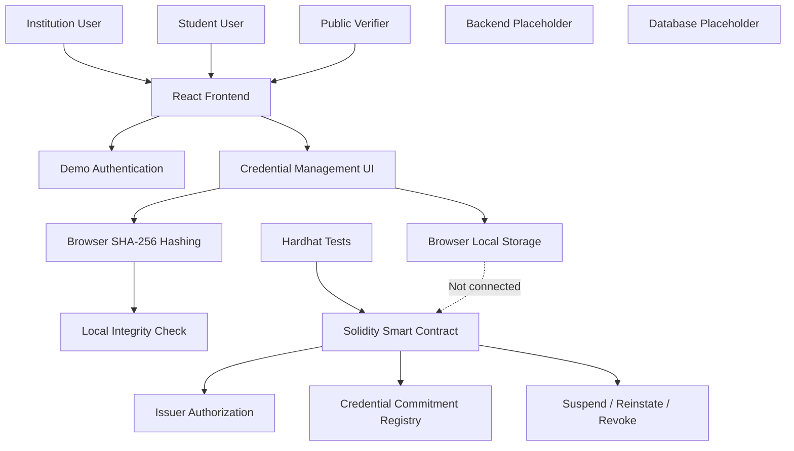

# EduChain
### Privacy-Aware Blockchain Platform for Verifiable Educational Credentials

EduChain is a prototype framework designed to demonstrate how blockchain technology and cryptographic hashing can support the integrity and verification of educational credentials in India.

## Problem Statement

**Design and Implementation of a Blockchain-Enabled Framework for Secure Educational Credentials in India.**

Traditional educational credentials can be difficult to verify efficiently and may be vulnerable to forgery or unauthorized modification. EduChain explores a privacy-aware approach to credential issuance and verification.

## Key Features

- **Institution Dashboard:** Demonstrates an institution-facing credential management interface.
- **Credential Issuance:** Provides a UI workflow for issuing educational credentials.
- **Student Wallet:** Displays credentials associated with a demo student account.
- **Credential Verification:** Demonstrates hash-based integrity checking.
- **Blockchain Registry:** Includes a Solidity smart contract for credential commitments and issuer authorization.
- **Credential Lifecycle:** The contract supports suspension, reinstatement, and revocation.
- **Privacy-Aware Design:** The smart contract stores credential commitments and related metadata rather than students' personal details.

## System Architecture

The project currently consists of two separate parts: a browser-based frontend
demonstration and an independently developed Solidity smart contract. The
frontend does not submit transactions to or read data from the contract.



### Frontend

- The institution interface demonstrates credential management and issuance
  workflows.
- The student interface displays credentials for a demo student account.
- The public verification interface checks credentials against locally stored
  demonstration data.
- Browser local storage holds the demo records, and browser SHA-256 hashing is
  used to demonstrate local integrity checking.
- Demo authentication is for demonstration only and is not production-grade
  authentication.
- The frontend demo accounts are `student.demo@example.test` /
  `StudentDemo@123` and `institution.demo@example.test` /
  `InstitutionDemo@123`. Session storage holds only the role and an eight-hour
  expiry; passwords are never stored in browser storage.
- The student account includes the synthetic `EDU-DEMO-STUDENT-001` record
  (`DEMO / LOCAL ONLY`). Its matching local SHA-256 hash does not establish
  issuer authenticity and is not blockchain-backed verification.

### Blockchain

The Solidity registry is developed and tested separately from the frontend.
It demonstrates issuer authorization, duplicate-resistant registration of
credential commitments, and credential suspension, reinstatement, and
revocation.

### Current Limitations

- Browser-local records are not shared across devices.
- A matching local hash demonstrates integrity only; it does not prove that an
  authorized institution genuinely issued the credential.
- The frontend is not connected to the smart contract and does not verify
  issuer authorization or credential status against an on-chain registry.
- The backend and database folders are documentation placeholders.

## Project Structure

```text
EduChain/
├── frontend/    # React + TypeScript + Vite application
├── blockchain/  # Solidity smart contract, tests and scripts
├── backend/     # Documentation placeholder
├── database/    # Documentation placeholder
├── package.json
├── pnpm-workspace.yaml
└── pnpm-lock.yaml
```

## Technology Stack

- **Frontend:** React, TypeScript, Vite, Tailwind CSS
- **Smart Contracts:** Solidity, Hardhat, OpenZeppelin
- **Development Tools:** Git, GitHub, pnpm

## Project Scope

EduChain is currently a **UI prototype and blockchain development demonstration**.

- The frontend uses browser-local demo authentication and local storage.
- Frontend credential verification demonstrates local hash-integrity checking; it is not yet connected to a live blockchain registry.
- The Solidity contract and its tests are maintained separately under `blockchain/`.
- The backend and database folders contain documentation placeholders; no production backend or database integration is implemented.

**Important:** The current prototype does not establish real-world credential authenticity, production-grade identity verification, or cross-device verification.

## Running the Project

Install [Node.js](https://nodejs.org/) and [pnpm](https://pnpm.io/).

From the project root:

```bash
pnpm install
pnpm run dev
```

Use the local URL printed by Vite to open the frontend in your browser.

## Smart Contract Tests

From the project root:

```bash
pnpm run contracts:test
```

## Future Scope

- Connect the frontend to a deployed smart contract.
- Implement secure institutional authentication.
- Add backend services and persistent storage.
- Integrate QR-based verification with verifiable credential proofs.
- Conduct security, privacy, and usability testing.

## Status

Academic prototype under development.